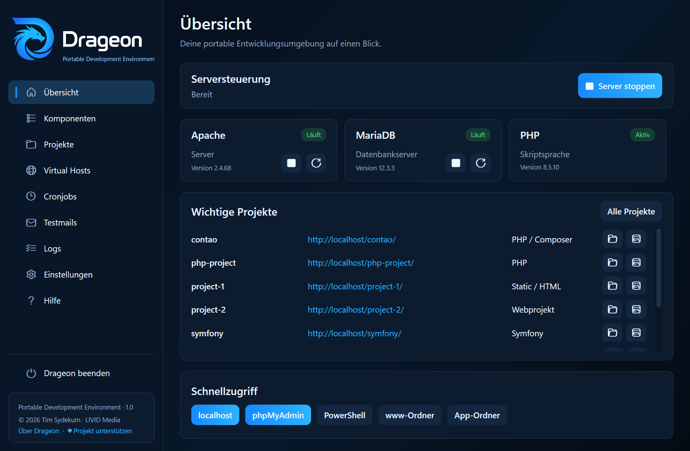
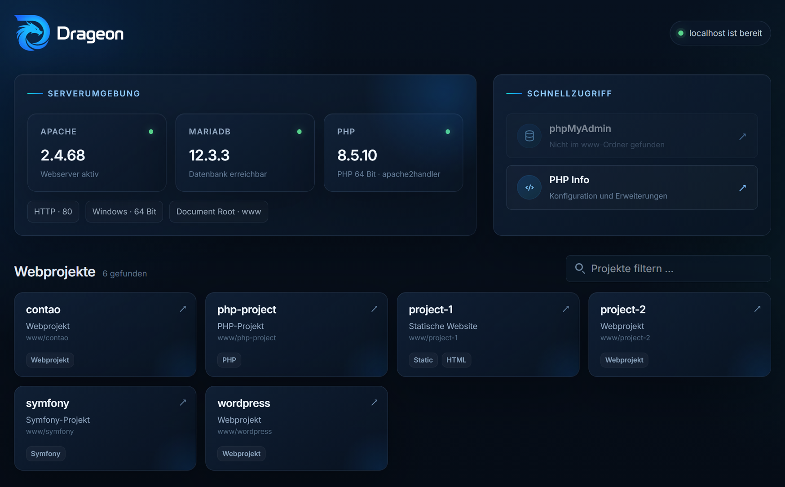
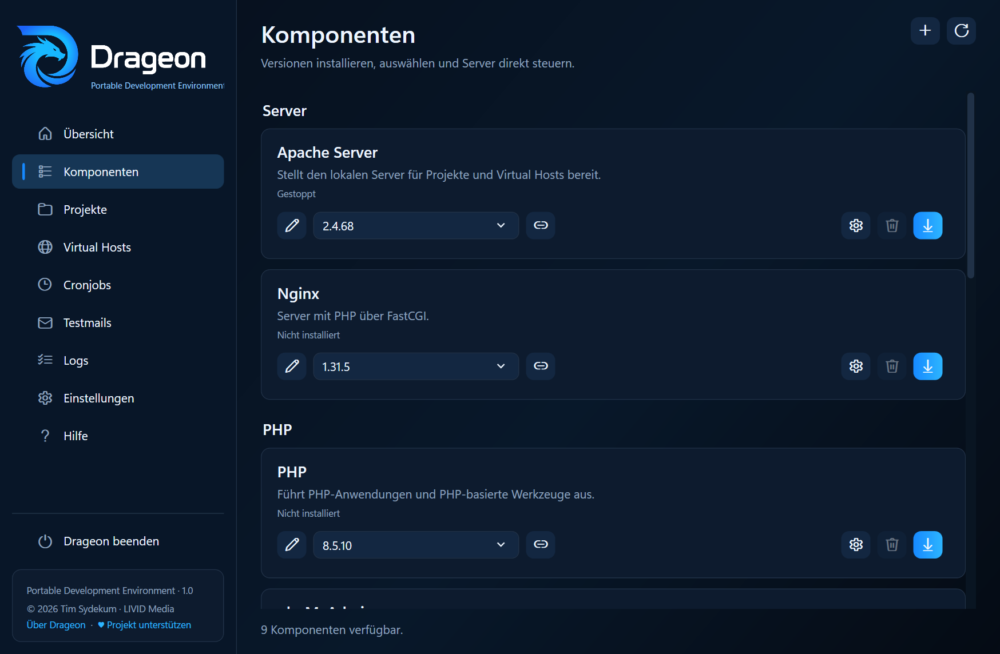
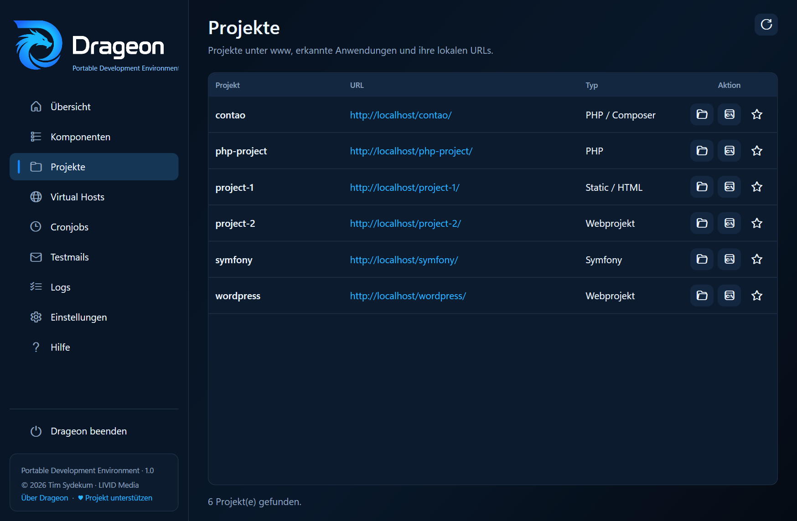
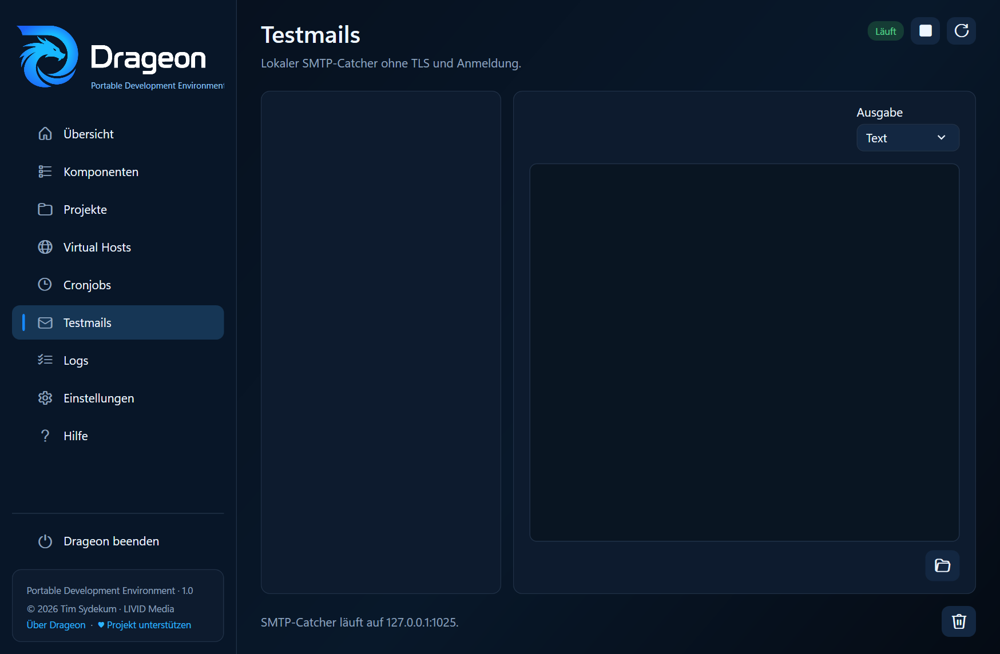

<div align="center">


# Drageon
<p><strong>Eine portable lokale Entwicklungsumgebung für Windows</strong></p>


</div>

[English](README.md) · **Deutsch**

Drageon bündelt den kompletten lokalen Webentwicklungs-Stack in einer schlanken Windows-App. **Apache oder Nginx, PHP, MariaDB oder MySQL, phpMyAdmin, Composer, Node.js, cURL, Projekte, Virtual Hosts, Backups, Snapshots, Staging, Cronjobs, Testmails und Logs** lassen sich über eine gemeinsame Oberfläche verwalten.

Programme, Projekte, Datenbanken und Einstellungen bleiben vollständig im Drageon-Ordner. Drageon benötigt keine Windows-Dienste, schreibt keine festen Installationspfade in die Registry und verändert den systemweiten `PATH` nicht.

Damit lässt sich die komplette Entwicklungsumgebung einfach kopieren, verschieben oder auf einem externen Laufwerk mitnehmen.



## Warum Drageon?

- **Wirklich portabel** – alle Pfade werden relativ zur `Drageon.exe` aufgelöst.
- **Eine App für den gesamten lokalen Stack** – Webserver, PHP, Datenbank, Projekte und Tools an einem Ort.
- **Mehrere Versionen parallel** – Komponenten lassen sich in verschiedenen Versionen installieren und bei Bedarf wechseln.
- **Apache oder Nginx** – der Webserver kann passend zum Projekt gewählt werden.
- **MariaDB oder MySQL** – beide Datenbank-Provider werden mit getrennten Datenverzeichnissen unterstützt.
- **Backups und Snapshots** – SQL-Backups erstellen, Datenbanken wiederherstellen und vollständige Projektzustände vor riskanten Änderungen sichern.
- **Portable Entwicklungs-Shell** – PowerShell erhält automatisch PHP und ausgewählte CLI-Werkzeuge.
- **Projektfreundlich** – Ordner unter `www/` werden automatisch erkannt; Virtual Hosts sind optional.
- **Praktische Entwicklerwerkzeuge** – Cron-Scheduler, SMTP-Catcher, zentrale Logs und Tray-Steuerung sind direkt integriert.
- **Erweiterbar** – eigene Paketmanifeste können zusätzliche Werkzeuge und Releases bereitstellen.
- **Mehrsprachig** – Deutsch, Englisch, Französisch, Spanisch, Italienisch und brasilianisches Portugiesisch sind bereits enthalten.

## Schnellstart

1. Drageon-Release herunterladen und entpacken.
2. `Drageon.exe` starten.
3. Unter **Komponenten** die gewünschten Versionen von Webserver, PHP und Datenbank installieren.
4. Projekte unter `www/` ablegen.
5. Server starten und `http://localhost/` öffnen.

Komponenten werden erst bei ihrer Installation heruntergeladen. So enthält jede Drageon-Umgebung nur die Laufzeiten und Werkzeuge, die tatsächlich benötigt werden.

> Veröffentlichte Builds sind selbstenthaltend. Auf dem Zielrechner ist keine separate .NET-Installation erforderlich.



## Komponenten

| Bereich | Unterstützung |
| --- | --- |
| Webserver | Apache HTTP Server, Nginx |
| PHP | mehrere Versionen, INI-Einstellungen, Erweiterungsverwaltung, OPcache |
| Datenbanken | MariaDB, MySQL |
| Datenbankoberfläche | phpMyAdmin |
| PHP-Werkzeuge | Composer |
| Frontend-Werkzeuge | Node.js, npm, npx |
| CLI / Diagnose | cURL |
| Lokale Dienste | Cron-Scheduler, SMTP-Catcher |

Installierte Versionen liegen unter `bin/` und können direkt in der App aktiviert, gewechselt oder entfernt werden. MariaDB und MySQL speichern ihre Daten getrennt unter `data/`, sodass beim Löschen einer Serverversion nicht automatisch die Datenbanken entfernt werden.



## Projekte und Virtual Hosts

Ordner direkt unter `www/` sind die einzige Quelle für tatsächlich vorhandene Projekte und werden automatisch erkannt. Drageon erkennt typische Projektstrukturen unter anderem für Contao/Symfony, Laravel, WordPress, Composer-/PHP-Projekte, Node-/Frontend-Projekte und statische HTML-Seiten. Das Anlegen eines Ordners erzeugt keinen Konfigurationseintrag.

Ohne zusätzliche Konfiguration ist beispielsweise

```text
www/mein-projekt/
```

direkt erreichbar unter

```text
http://localhost/mein-projekt/
```

`app/config/projects.json` enthält ausschließlich optionale Einstellungen für Projekte, die ausdrücklich konfiguriert wurden. Dazu können Anzeigename, Favoritenstatus, zugeordnete Datenbank, eigene URL, verknüpfter Virtual Host oder eine Staging-Beziehung gehören. Nicht mehr vorhandene Projektordner werden beim Einlesen aus dieser Metadatendatei entfernt.

Einem Projekt kann eine vorhandene Benutzerdatenbank des aktiven MySQL- oder MariaDB-Servers zugeordnet werden. Diese Zuordnung ermöglicht datenbankgestützte Snapshots und Staging-Kopien; sie macht Drageon nicht zu einer allgemeinen Datenbankverwaltung. Ist eine zugeordnete Datenbank nicht mehr verfügbar, bleibt die Zuordnung sichtbar, bis sie bewusst geändert oder entfernt wird.

Optional können Virtual Hosts direkt in Drageon angelegt werden:

```json
{
  "host": "website.localhost",
  "documentRoot": "www/website/public",
  "enabled": true,
  "port": 80
}
```

Dieselbe Virtual-Host-Definition kann von Apache und Nginx verwendet werden; serverspezifische Zusatzregeln bleiben getrennt konfigurierbar. Ein Virtual Host kann optional einem erkannten Projekt zugeordnet werden. Umbenennen, Neuzuordnen oder Löschen des Hosts aktualisiert die Projektmetadaten, ohne das Projekt selbst anzulegen oder zu löschen.

Über die Projektwerkzeuge lassen sich vollständige Snapshots unter `data/snapshots/` erstellen. Dateien, Dotfiles, leere Ordner, Symlinks, Verzeichnislinks und Junctions bleiben erhalten, ohne externe Link-Ziele zu kopieren. Eine zugeordnete Datenbank, Projektmetadaten und die relevante Virtual-Host-Definition werden einbezogen, sofern vorhanden. Vor einer Wiederherstellung kann der aktuelle Zustand automatisch als Sicherheitssnapshot gespeichert werden.

Von Hauptprojekten können lokale Staging-Kopien erzeugt werden. Drageon kopiert den Projektbaum mit angepassten internen Link-Zielen und kann optional die zugeordnete Datenbank sowie einen Virtual Host kopieren. Für mehrere Instanzen werden nummerierte Vorschläge erzeugt. Projektdateien werden nicht verändert, um CMS-spezifische Datenbankzugänge einzutragen; nach einer Datenbankkopie muss die Verbindung im Staging deshalb manuell angepasst werden. Beim Löschen einer Staging-Instanz entfernt Drageon nach Bestätigung auch den erzeugten Virtual Host, die optionale Datenbank, Metadaten und alle zugehörigen Snapshots.



## Datenbank-Backups

Die Seite **Datenbank-Backups** zeigt ausschließlich Benutzerdatenbanken der aktuell aktiven MySQL- oder MariaDB-Version. Eine, mehrere oder alle Datenbanken können gesichert werden; jede Datenbank erhält einen eigenen SQL-Dump unter `data/backups/databases/`. Vorhandene Backups lassen sich nach Bestätigung in eine ausdrücklich gewählte Zieldatenbank wiederherstellen oder löschen.

Die Zugangsdaten werden verschlüsselt in den versionsbezogenen Komponenteneinstellungen gespeichert und bleiben zusammen mit dem Drageon-Ordner portabel. Drageon verwendet die Client-Werkzeuge der aktiven Datenbankversion. Tabellen, SQL-Abfragen, Benutzer, Rechte, Kollationen und Strukturänderungen bleiben Aufgabe von phpMyAdmin.

## Portable PowerShell

Eine aus Drageon gestartete PowerShell erhält temporär einen Entwicklungs-`PATH` mit der aktiven PHP-Version und allen dafür freigegebenen CLI-Komponenten.

Dadurch funktionieren Befehle wie

```powershell
php -v
composer install
npm run dev
curl --version
```

ohne globale Installation.

Wird PowerShell aus einem Projekt heraus geöffnet, startet sie direkt im jeweiligen Projektordner.

Drageon erlaubt die Skriptausführung ausschließlich für den gestarteten PowerShell-Prozess. Dadurch funktionieren auch Node.js-Starter wie `npm.ps1` bei einer restriktiven Windows-Ausführungsrichtlinie, ohne die systemweite Richtlinie zu ändern.

## PHP-Konfiguration

PHP-Einstellungen werden für jede installierte Version getrennt verwaltet. Einstellbar sind unter anderem:

- `memory_limit`
- maximale Upload- und POST-Größe
- maximale Ausführungszeit
- Fehleranzeige
- OPcache mit getrenntem Cache pro PHP-Version
- automatisch erkannte PHP-Erweiterungen
- zusätzliche eigene INI-Direktiven

Die erzeugte PHP-Konfiguration wird einheitlich von Apache, Nginx/PHP-FastCGI, PHP-Cronjobs und der portablen PowerShell verwendet.

## Cronjobs und Testmails

Der integrierte Scheduler läuft, solange Drageon geöffnet ist. Cronjobs können unter anderem folgende Ziele ausführen:

- PHP-Skripte
- HTTP-URLs
- cURL-Aufrufe
- lokale Programme, Batchdateien und Befehle

Verpasste Ausführungen können beim nächsten App-Start optional nachgeholt werden.

Der integrierte SMTP-Catcher lauscht standardmäßig auf `127.0.0.1:1025` und benötigt weder TLS noch Anmeldung. Testmails und Anhänge werden portabel unter `data/mail/` gespeichert und können direkt in Drageon betrachtet werden.



## Paketmanifeste

Die Komponentenverwaltung basiert auf Paketmanifesten. Über den integrierten Manifest-Editor können zusätzliche Werkzeuge und Releases hinzugefügt werden.

Definierbar sind beispielsweise:

- Anzeigename und Kategorie
- Hersteller-Downloadseite
- Installationsverzeichnis
- ZIP-Archiv oder Einzeldatei
- Download-URL
- optionale SHA256-Prüfsumme
- optionaler Archiv-Stammordner
- Browser-Startpfad
- Einbindung in den portablen `PATH`

Dadurch bleibt Drageon flexibel, ohne jedes zusätzliche Werkzeug fest im Programmcode hinterlegen zu müssen.

<details>
<summary><strong>Portable Ordnerstruktur</strong></summary>

```text
Drageon/
├─ Drageon.exe
├─ app/
│  ├─ config/
│  ├─ languages/
│  ├─ packages/
│  └─ var/
│     ├─ generated/
│     ├─ logs/
│     └─ tmp/
├─ bin/
│  ├─ apache/
│  ├─ composer/
│  ├─ curl/
│  ├─ mariadb/
│  ├─ mysql/
│  ├─ nginx/
│  ├─ node/
│  ├─ php/
│  └─ phpmyadmin/
├─ data/
│  ├─ backups/databases/
│  ├─ cron/
│  ├─ mail/
│  ├─ mariadb/
│  ├─ mysql/
│  └─ snapshots/
└─ www/
```

Alle Pfade werden vom Speicherort der `Drageon.exe` abgeleitet. Vor dem Verschieben oder Kopieren sollten alle von Drageon gestarteten Prozesse beendet werden.

</details>

<details>
<summary><strong>Selbst kompilieren</strong></summary>

Voraussetzungen:

- Windows 10 oder 11 x64
- [.NET 10 SDK](https://dotnet.microsoft.com/download/dotnet/10.0)
- keine zusätzlichen NuGet- oder Node-Pakete

Self-contained Windows-x64-Build erstellen:

```text
.\scripts\publish-drageon-win-x64.cmd
```

oder:

```powershell
.\scripts\publish-drageon-win-x64.ps1
```

Die portable Ausgabe wird unter folgendem Pfad erzeugt:

```text
publish/win-x64/
```

</details>

## Sprachen

Drageon enthält derzeit:

- Deutsch
- Englisch
- Französisch
- Spanisch
- Italienisch
- portugiesisch (Brasilien)

Die Oberflächentexte liegen in JSON-Sprachdateien und können um weitere Übersetzungen ergänzt werden.

## Lizenz

Drageon ist freie Open-Source-Software unter der [Mozilla Public License 2.0](LICENSE).

## Unterstützen

Wenn Drageon für dich nützlich ist und du die Weiterentwicklung unterstützen möchtest:

- [Ko-fi](https://ko-fi.com/livid_media)
- [PayPal](https://www.paypal.com/donate/?hosted_button_id=93Z5AXMPT25EE)

## Haftungsausschluss

Drageon wird ohne Gewährleistung bereitgestellt. Die Nutzung erfolgt auf eigene Verantwortung. Erstellen Sie vor größeren Änderungen stets Sicherungskopien wichtiger Projekte und Datenbanken.
