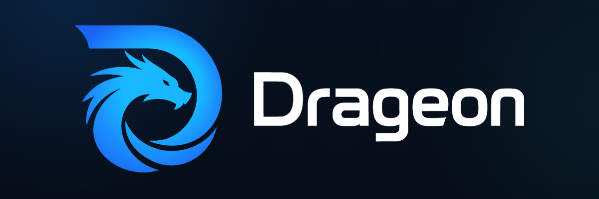
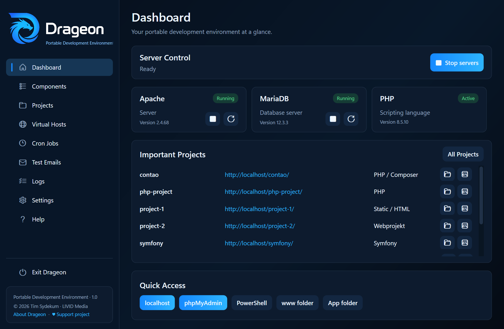
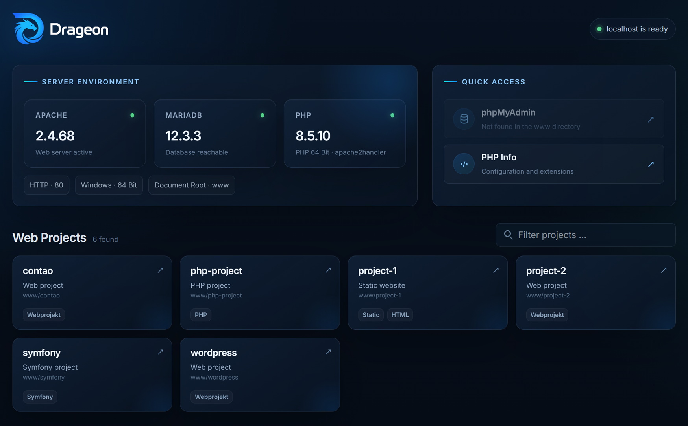
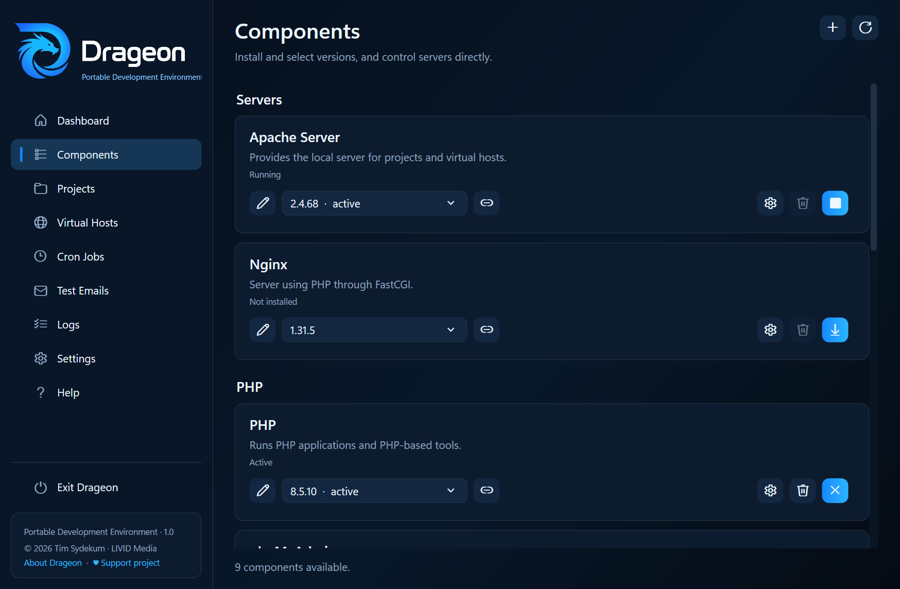
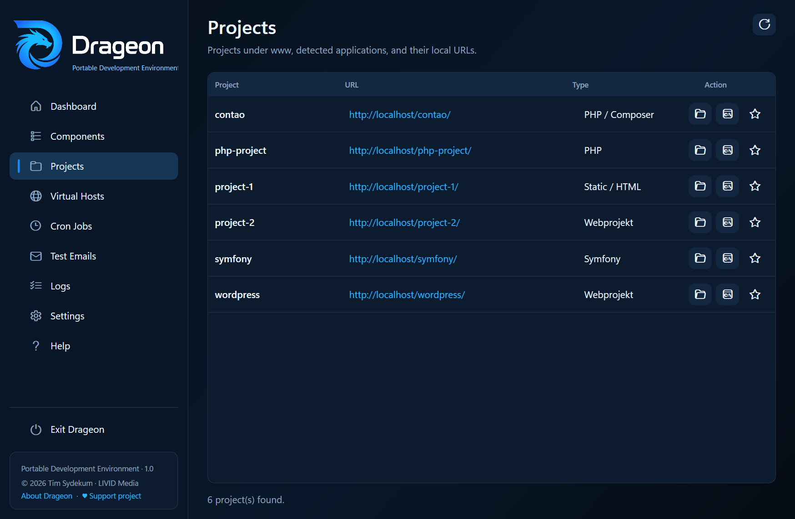
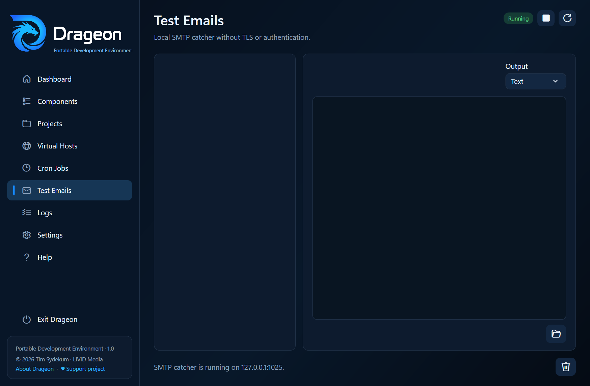

<div align="center">


# Drageon
<p><strong>A portable local development environment for Windows</strong></p>


</div>

**English** · [Deutsch](README.de.md)

Drageon brings your local web development stack into one lightweight Windows application. Manage **Apache or Nginx, PHP, MariaDB or MySQL, phpMyAdmin, Composer, Node.js, cURL, projects, virtual hosts, backups, snapshots, staging, cron jobs, test emails and logs** from a single interface.

Everything stays inside the Drageon folder: applications, projects, databases and configuration. Drageon does not rely on Windows services, does not write fixed installation paths to the registry and does not modify the system-wide `PATH`.

Copy it, move it or keep it on an external drive — your development environment stays together.



## Why Drageon?

- **Truly portable** — paths are resolved relative to `Drageon.exe`.
- **One app for the complete local stack** — web server, PHP, database, projects and tools in one place.
- **Multiple versions side by side** — install and switch between component versions when needed.
- **Apache or Nginx** — choose the web server that fits your project.
- **MariaDB or MySQL** — both database providers are supported with separate data directories.
- **Backups and snapshots** — create SQL backups, restore databases, and capture complete project states before risky changes.
- **Portable developer shell** — PowerShell automatically receives the active PHP environment and selected CLI tools.
- **Project friendly** — folders under `www/` are detected automatically; virtual hosts are optional.
- **Built-in development helpers** — cron scheduler, SMTP catcher, centralized logs and tray controls.
- **Extensible** — add or edit package manifests without hard-coding every tool into the application.
- **Multilingual** — German, English, French, Spanish, Italian and Brazilian Portuguese are included.

Visit the project website: [drageon.livid-media.de](https://drageon.livid-media.de/)

## Quick start

1. Download and extract a Drageon release.
2. Start `Drageon.exe`.
3. Open **Components** and install the versions of your web server, PHP and database that you need.
4. Place projects inside `www/`.
5. Start the servers and open `http://localhost/`.

Components are downloaded only when you install them, so each Drageon setup contains only the runtimes and tools you actually use.

> Published builds are self-contained. No separate .NET installation is required on the target PC.



## Components

| Category | Included support |
| --- | --- |
| Web servers | Apache HTTP Server, Nginx |
| PHP | Multiple versions, INI settings, extension management, OPcache |
| Databases | MariaDB, MySQL |
| Database UI | phpMyAdmin |
| PHP tooling | Composer |
| Frontend tooling | Node.js, npm, npx |
| CLI / diagnostics | cURL |
| Local services | Cron scheduler, SMTP catcher |

Installed versions live under `bin/` and can be activated, switched or removed from the app. MariaDB and MySQL keep their data separately under `data/`, so removing a server version does not automatically remove its databases.



## Projects and virtual hosts

Folders directly below `www/` are the sole source of existing projects and are detected automatically. Drageon recognizes common project types including Contao/Symfony, Laravel, WordPress, Composer/PHP projects, Node/frontend projects and static HTML sites. Adding a folder does not create a configuration entry.

Without any additional configuration, a folder such as

```text
www/my-project/
```

is available through

```text
http://localhost/my-project/
```

`app/config/projects.json` contains optional settings only for projects that were configured explicitly. These settings can include a display name, favorite state, assigned database, custom URL, associated virtual host, or staging relationship. Metadata for missing project folders is retained so scans do not treat temporary exchange/recovery windows as deletion. Explicit staging deletion removes its metadata.

An existing user database from the active MySQL or MariaDB server can be assigned to a project. The assignment enables database-aware snapshots and staging; it does not turn Drageon into a general database manager. If an assigned database is no longer available, Drageon keeps the assignment visible until it is deliberately changed or removed.

Optional virtual hosts can be created directly in Drageon, for example:

```json
{
  "host": "website.localhost",
  "documentRoot": "www/website/public",
  "enabled": true,
  "port": 80
}
```

The same virtual-host definition can be used by Apache and Nginx, with separate advanced configuration where needed. A virtual host can optionally be linked to a detected project; renaming, reassigning, or deleting the host updates the project metadata without creating or deleting the project itself.

The project tools can create complete snapshots under `data/snapshots/`. They preserve files, dotfiles, empty directories, symbolic links, directory links, and junctions without copying linked external content. An assigned database, project metadata, and relevant virtual-host definition are included when available. Restoring a snapshot can first preserve the current state as a safety snapshot.

Local staging copies can be created from main projects. Drageon copies the project tree with link-aware paths and can optionally copy the assigned database and create a virtual host. Multiple instances receive numbered suggestions. Project files are never modified to inject CMS-specific database settings, so the staging database connection must be updated manually after a database copy. Staging deletion checks a separate creation record, directory identity, VHost checksum, project ownership and other references. Unclear, foreign, repurposed or shared resources cause an abort before changes. The owned staging database is also deleted when its original assignment and the Windows identities recorded at exclusive creation for server storage, system schema and staging schema are unchanged. A recovery SQL dump is captured before deletion; shared references, another server or a replaced database abort before changes. This is supported only for local servers with data directories within this Drageon instance and database names containing ASCII letters, digits and underscores. Older instances without database creation proof cannot be deleted automatically. After reversible project relocation, project cleanup precedes removal of the proven owned VHost and metadata; snapshots are moved to the recovery folder last. Files, SQL dump, VHost, metadata and snapshots remain available during deletion for recovery. After successful deletion, these temporary recovery copies, snapshots, ownership records and completed operation files are removed. The confirmation explains permanent deletion; failures retain required recovery data. Successful staging creation also removes its operation files.

### Safety and recovery

New database backups and snapshot folders use a timestamp including seconds and milliseconds separated by underscores, without a random identifier. Existing backups keep their names.

New snapshots use format 3: `files.zip` stores regular files and link entries carrying target text (without target contents), `files.index.json` stores a compact index and `snapshot.json` contains only the small listing header. Sizes and SHA-256 checksums protect files, archive, index and SQL dump. File contents stream through a 128 KiB buffer; the ZIP directory and index use memory proportional to entry count, not payload size. Compression uses the fast level. Symbolic links, directory links and junctions retain their type and target in the index and are explicitly recreated; ordinary ZIP extraction cannot reliably restore Windows links. Earlier format-3 archives with index-only links remain readable. Staging creation uses the same mechanism with an uncompressed temporary ZIP; new staging deletion recovery data is compressed. Format 2 loose-file snapshots remain readable. The actual snapshot location determines its address; manifest addresses never select deletion targets. Absolute entry paths, traversal, invalid names, unknown types, missing link targets, duplicate paths and link/descendant conflicts are rejected. Snapshot sources and their ancestors cannot contain unexpected reparse points. Legacy snapshots without a version remain readable after path and completeness checks; missing historical checksums cannot provide a retrospective integrity guarantee. Empty projects remain supported. Legacy staging metadata without a separate creation record never grants automatic deletion ownership.

File restoration prepares the entire tree in a unique sibling directory. Before the first rename, an operation journal is written with `WriteThrough` and `Flush(true)`. The previous folder is then moved to `<project>.previous-<ID>` and the prepared tree installed. Internal links point at the final project path; external targets are neither copied nor cleaned. Preparation failure leaves the project unchanged; exchange failure attempts rollback independently of the cancelled user token. Failed rollback retains the previous tree and journal and reports their paths. This protection also applies with the optional safety snapshot disabled. After successful restoration, the previous tree and both journals are archived in `data/recovery/restore-<ID>/`, leaving no operation artifacts in `www`. Simple staging creation into an absent target removes its completed file journal; combined restores retain their recovery state.

Combined restoration restores files, the snapshot database, the project-owned VHost and metadata. Conflicts and expected SQL dumps are checked before existing resources change. The full new file tree is prepared first; the actual existing target database is backed up independently of the project folder or its current database assignment. An additional current-project snapshot is optional and does not replace this mandatory recovery path. New snapshots receive an independent creation receipt proving their historical database assignment; older snapshots without this receipt require the target database to remain assigned to the project. Foreign, reassigned or shared VHosts and shared target databases abort before mutations. Automatic combined database restoration requires a local server, an unlinked data directory within Drageon and an ASCII letters/digits/underscore schema name, so actual server storage and schema incarnation can be verified during compensation. Unsupported combinations abort before mutations with a concrete reason.

Import, exchange or later failures attempt to recover database, files, VHost and metadata without the cancelled user token. No overall atomicity is claimed. Durable state at `<project>.restore-operation-<ID>.json` and backups in `data/recovery/restore-<ID>/` enable resumable compensation; during the operation the previous tree is at `<project>.previous-<ID>`, then archived at `data/recovery/restore-<ID>/files.before`. Archived coordinator and file journals are named `restore.operation.json` and `files.operation.json`. `RecoverProjectRestoreAsync` accepts either coordinator location and can recover interrupted archival. Cleanup failure after completion reports a completed restore with retained artifacts. Failed compensation explicitly reports required manual recovery and backup paths. External SQL clients and filesystem writers must remain quiescent during the operation. Database copying uses exclusive `CREATE DATABASE` without a preceding `DROP`; incomplete copies retain their source dump and journal for review.

Snapshot/staging mutations, metadata assignments and VHost changes are serialized in the services; database service instances share another gate. Confirmation dialogs show a fresh plan containing paths, target database, VHosts, information and snapshot list. Services recheck the plan; changes require confirmation again. Web server restart failure is reported separately from a completed operation. The app already prevents concurrent instances for the same portable directory. Other SQL clients and external filesystem changes do not participate in these gates; restore a quiescent project. No overall atomicity is claimed across files, SQL, VHosts and metadata.

After a process interruption, inspect the reported journal and preserve recovery artifacts first. Service APIs `RecoverFileExchangeAsync(journal, expectedProjectPath)`, `RecoverDeletionAsync(journal, expectedProjectPath)` as well as `RecoverProjectRestoreAsync(journal, expectedProjectPath, connection)` and `RecoverDatabaseAsync(journal, expectedDatabase, connection)` validate expected resources and perform their recovery paths. Existing foreign targets and VHost conflicts are preserved and cause an abort. Partially deleted staging files are retained in `<project>.recovery-<ID>/files.zip` (legacy recovery data: `files/`), with the entry manifest, metadata and VHost alongside and relocated snapshots in `snapshots/`; a partial tree may remain under `<project>.delete-<ID>`. Failed recovery requires manual review of these paths. Remove recovery artifacts explicitly only after checking the result. Actual power loss, full disks and concurrent external programs are not protected by an overall transaction.


## Database backups

The **Database Backups** page lists only user databases from the currently active MySQL or MariaDB version. One, several, or all databases can be backed up; every database receives its own SQL dump under `data/backups/databases/`. Existing backups can be restored into an explicitly selected target database or deleted after confirmation.

Database credentials are stored encrypted in the version-specific component settings and remain portable with the Drageon directory. Drageon uses the client tools supplied by the active database version. phpMyAdmin remains responsible for tables, SQL queries, users, permissions, collations, and structural changes.

## Portable PowerShell

PowerShell sessions started from Drageon receive a temporary development `PATH` containing the active PHP version and all enabled CLI components.

That means commands such as these can work without global installations:

```powershell
php -v
composer install
npm run dev
curl --version
```

Opening PowerShell from a project starts the terminal directly inside that project folder.

Drageon enables script execution only for the PowerShell process it starts. This allows Node.js wrappers such as `npm.ps1` to run even when Windows uses a restrictive execution policy, without changing the system-wide policy.

## PHP configuration

PHP settings are stored per installed version. Drageon can manage, among other things:

- `memory_limit`
- upload and POST size
- maximum execution time
- error display
- OPcache with a separate cache per PHP version
- detected PHP extensions
- additional custom INI directives

The generated configuration is used consistently by Apache, Nginx/PHP-FastCGI, PHP cron jobs and the portable PowerShell environment.

## Cron jobs and test emails

Drageon includes a lightweight scheduler that runs while the application is open. Jobs can execute:

- PHP scripts
- HTTP URLs
- cURL calls
- local programs, batch files and commands

Missed jobs can optionally be executed when Drageon starts again.

The built-in SMTP catcher listens on `127.0.0.1:1025` by default and requires neither TLS nor authentication. Incoming test messages and attachments are stored locally under `data/mail/` and can be inspected directly in the app.



## Package manifests

Drageon's component manager is driven by package manifests. New tools and releases can be added from the integrated manifest editor.

A package can define, for example:

- display name and category
- download page
- installation directory
- ZIP archive or single-file download
- release URL
- optional SHA256 checksum
- optional archive prefix
- browser launch path
- portable `PATH` integration

This keeps the application flexible without requiring every downloadable tool to be hard-coded.

<details>
<summary><strong>Portable folder structure</strong></summary>

```text
Drageon/
├─ Drageon.exe
├─ app/
│  ├─ config/
│  ├─ languages/
│  ├─ packages/
│  └─ var/
│     ├─ generated/
│     ├─ logs/
│     └─ tmp/
├─ bin/
│  ├─ apache/
│  ├─ composer/
│  ├─ curl/
│  ├─ mariadb/
│  ├─ mysql/
│  ├─ nginx/
│  ├─ node/
│  ├─ php/
│  └─ phpmyadmin/
├─ data/
│  ├─ backups/databases/
│  ├─ cron/
│  ├─ mail/
│  ├─ mariadb/
│  ├─ mysql/
│  └─ snapshots/
└─ www/
```

All paths are derived from the location of `Drageon.exe`. Stop processes started by Drageon before moving or copying the folder.

</details>

<details>
<summary><strong>Build from source</strong></summary>

Requirements:

- Windows 10 or 11 x64
- [.NET 10 SDK](https://dotnet.microsoft.com/download/dotnet/10.0)
- no additional NuGet or Node packages

Create a self-contained Windows x64 build with:

```text
.\scripts\publish-drageon-win-x64.cmd
```

or:

```powershell
.\scripts\publish-drageon-win-x64.ps1
```

The portable build is generated under:

```text
publish/win-x64/
```

</details>

## Languages

Drageon currently includes:

- German
- English
- French
- Spanish
- Italian
- Portuguese (Brazil)

UI strings are stored in JSON language files, making additional translations easy to add.

## License

Drageon is open-source software licensed under the [Mozilla Public License 2.0](LICENSE).

## Support

If Drageon is useful to you and you would like to support its development:

- [Ko-fi](https://ko-fi.com/livid_media)
- [PayPal](https://www.paypal.com/donate/?hosted_button_id=93Z5AXMPT25EE)

## Disclaimer

Drageon is provided as-is. Use it at your own risk and keep backups of important projects and databases before making major changes.

Snapshot and staging operations show progress in the main window even after closing the project tools or changing pages. File processing also displays the number of processed entries.

Snapshot restoration does not stop or restart the web server. File exchange precedes SQL import, so a blocked exchange leaves the database unchanged. Successful rollback removes proven preparation directories and archives journals in data/recovery. Cleanup failures report retained paths; foreign replacement directories are preserved.

Transient directory rename refusals use bounded native retries with repeated identity checks. Existing destinations are never replaced; persistent locks abort safely and report the Windows error code.
